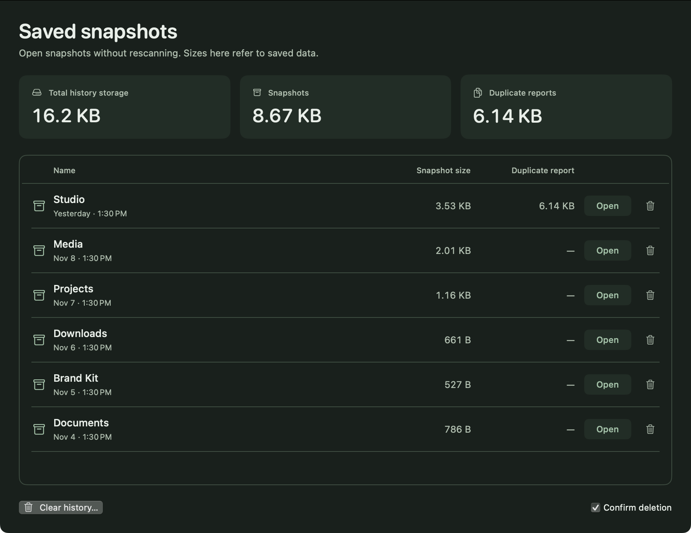

<div align="center">
  
  <h1>Disk Atlas</h1>
  <p><strong>Room for what matters.</strong></p>
  <p>A native map of your Mac’s storage. Built for people and agents.</p>
  <p><a href="https://github.com/ai-babai/disk-atlas/releases">Download for macOS</a> · <a href="README.ru.md">По-русски</a> · <a href="docs/ARCHITECTURE.md">Architecture</a> · <a href="#contact">Contact</a></p>
  <p>macOS 14+ · Apple Silicon & Intel · English / Русский · Early access</p>
</div>


*Native interface preview with illustrative data. Your files stay on your Mac.*

## Make space understandable

Choose what to analyze first. Add several folders, review the selection, then
start the scan. Explore the treemap, follow the largest folders, filter by type
or find an item by name. Open an earlier scan whenever you need to return to it.

- **A map and a real file list.** Allocated or logical sizes, scoped search,
  largest files, sortable dates and sizes, size/date view filters and a focused inspector.
- **Duplicates, on your terms.** An explicit background check, a cost estimate first,
  pause/stop controls and one-click access to confirmed copies from the file list.
- **Your scope, your choice.** Multiple folders, drag and drop, common locations,
  overlap detection and no scan until you press Analyze.
- **History that remembers.** Local compressed results, dates and sizes; opening
  a snapshot does not rescan its folders. Reading and map preparation have visible stages.
- **Native comfort.** Smooth native pane transitions preserve dragged widths and honor Reduce Motion. Resizable and collapsible sidebars, one compact toolbar,
  light/dark themes and English/Russian UI, with a compact language menu in the
  toolbar. Double-click a file to reveal it in Finder.
- **The same data for agents.** CLI, JSON output and an MCP server share the scan core.

## Download & install

1. Open [Releases](https://github.com/ai-babai/disk-atlas/releases).
2. Download **Disk-Atlas-0.4.0-universal.dmg**. The same app supports Apple Silicon
   and Intel Macs running **macOS 14 Sonoma or later**.
3. Open the DMG and drag **Disk Atlas.app** to **Applications**. Eject the image,
   then launch the app from Applications. A ZIP is also available.

This ordinary build is **ad hoc signed and not notarized by Apple**. On another
Mac, Gatekeeper may block the first launch. After verifying the download source,
follow [Apple’s instructions](https://support.apple.com/102445): attempt to open
it, then check **System Settings → Privacy & Security → Open Anyway**. Do not
turn off Gatekeeper globally. A paid Apple Developer membership is not required
to build this version; a notarized distribution would need a Developer ID setup.

Optional integrity check, with both downloaded artifacts beside the checksum file:

```sh
shasum -a 256 -c SHA256SUMS.txt
```


## A quiet, deliberate workflow

1. **Choose folders.** Drop folders, use the multiple-selection picker or quick locations.
2. **Analyze.** See progress and stop when needed. Cancelling a new scan keeps the previous result.
3. **Explore.** Single-click to select; double-click a folder to go inside or a file to reveal it in Finder.
4. **Return later.** Use scan history, or export a portable `.atlas` snapshot.

| Shortcut | Action |
| --- | --- |
| ⌘O / ⇧⌘O | New scan / open snapshot |
| ⌘S / ⌘R / ⌘. | Export / rescan / stop |
| ⌘↑ / Return | Go up / explore folder or reveal file |
| ⌘B / ⌥⌘I | Toggle navigation / inspector |
| ⇧⌘C | Copy the current scope as agent-friendly JSON |

Choose **Map / Largest files** inside **Disk usage**. Click a column heading to sort
by name, creation date, modification date, size or share; click again to reverse.
The **Filters** button beside the view modes affects both the map and list,
without changing the saved scan. Its two-handle slider supports presets and exact
bounds. Size criteria always use logical file bytes. Reset restores the full scan.

The list renders up to 1,000 matches and shows the total count. Search and type
filters affect the list; the map keeps showing the whole current folder. Click any
part of a file-type row to toggle it. Several types can be selected together;
**All** or the compact filter badge clears the selection. Search narrows the selected types. Missing
creation dates are omitted from the inspector, and the column hides when no
visible row has that date. Dates describe the time of the scan, not live changes.

Allocated size (**On disk**) is the default. The **Size** menu with a drive icon contains
**File size** when logical bytes are needed. Clicking a map tile selects and scrolls
to its entry in the list; a nested file reveals its parent folder. Double-clicking
a folder still opens it. Aggregated **More…** tiles do not select a file.

## Check duplicates when you need them

Duplicate checking is **off by default** and separate from the storage map.

1. Select **Find duplicates** before scanning. Size presets and the range slider
   appear immediately. Checking may take time; when the storage map is ready, the
   background check starts automatically. There is no second Start button.
2. The lower status strip shows the phase, time estimate and pause/stop controls.
   The map and list remain usable. Duplicate checking covers all dates.
3. Sort groups by repeated bytes, copy size, copy count or name; click a column heading
   to reverse its order. Expand a group to compare locations and reveal a copy in Finder. A small copies
   icon beside a known file opens its exact group, without checking again.

For an existing scan that was not opted in, open **Duplicates**, review the
candidates and read/time estimate, then press **Start comparison**. **Options**
contains size bounds and optional file types.


Different sizes are never compared. The checker samples the first and last 64 KiB,
fully hashes only surviving candidates with SHA-256, then confirms matches byte by
byte. Files up to 1 MiB use one full hash instead of an extra sampling pass.
Hard-link aliases count once; symlinks, special files and cloud-only placeholders
are skipped. Changed or replaced files are rejected.

Time estimates are broad planning ranges, not benchmarks: drive speed, file count
and matching content affect the result. The GUI compares files of any age;
advanced date criteria remain available through CLI/MCP. A check uses files known
to the source scan; rescan to include newly added files. Results carry their check
date and can become stale. Stopping preserves confirmed groups as a partial report.
Checkboxes select copies for **Trash**. A group checkbox selects **every copy**. Individual checkboxes have no hidden
keep-one restriction. Fully selected groups show **All copies selected**, even
when collapsed, and the review warns that no copy will remain. Row/group trash buttons
and the selection bar always open a review listing every selected path and any
remaining copies. After confirmation, the GUI rechecks contents in the background,
checks identities again, then moves files to macOS Trash. It never permanently
deletes them or falls back to deletion if Trash fails. Stop preserves already
moved files in Trash; changed/unavailable files abort the operation. Finder can
restore trashed files. Rescan to update the dated storage map. Repeated logical
bytes are not guaranteed reclaimable APFS space.

The overview and folder inspector link to confirmed copies within that folder;
no empty duplicate badge is shown before a result. Sort using table headings.
The info button beside **Size** explains allocated blocks versus content length.


## For agents

The CLI is bundled inside the app. It can also be linked to a directory on your PATH.

```sh
ATLAS="/Applications/Disk Atlas.app/Contents/MacOS/disk-atlas"
"$ATLAS" scan "$HOME/Downloads" "$HOME/Desktop" --json --output /tmp/scan.atlas
"$ATLAS" inspect /tmp/scan.atlas --files --limit 20
"$ATLAS" show /tmp/scan.atlas
# Metadata estimate only; no content reading:
"$ATLAS" duplicates "$HOME/Downloads" --min-bytes 100000000
# Separately authorize content reading and save a new report:
"$ATLAS" duplicates "$HOME/Downloads" --read-contents --output /tmp/duplicates.json
```

MCP client configuration:

```json
{
  "mcpServers": {
    "disk-atlas": {
      "command": "/Applications/Disk Atlas.app/Contents/MacOS/disk-atlas",
      "args": ["mcp"]
    }
  }
}
```

Tools: `scan_directory` (`path` or `paths`, optional `output`),
`inspect_snapshot` (`snapshot`, optional `path`, `files`, `limit`) and
`show_snapshot` (`snapshot`), plus `plan_duplicates` (metadata only) and
`find_duplicates` (requires explicit `readContents: true`). Duplicate tools take
`paths`, optional `minimumBytes`, `maximumBytes`, ISO 8601 `modifiedAfter` /
`modifiedBefore` and `kinds`. CLI equivalents are `--min-bytes`, `--max-bytes`,
`--modified-after`, `--modified-before` and `--types`. Sizes in JSON are bytes. `inspect` returns 1–500
items, 50 by default. Existing snapshot files are never overwritten by CLI/MCP.
Errors are structured JSON on stderr with exit code 1.

MCP uses stdio, with no network listener. Requests run sequentially; per-request
MCP progress and cancellation are not implemented yet. The GUI’s **For agents**
button copies configuration using the app’s actual installation path.

## Local by design

Ordinary scans and duplicate preparation read **metadata**. Only the separate
opt-in duplicate check reads file contents, locally. The scanner includes hidden files and application packages,
does not follow symlinks, and counts hard links once across selected roots. It
has no deletion, moving, content execution, networking or privilege escalation
operations. Protected directories can be skipped and appear in the issue list.

- **On disk:** allocated blocks reported by `lstat.st_blocks × 512`.
- **File size:** logical bytes reported by `lstat.st_size`.
- APFS clones, shared blocks, snapshots and purgeable space mean these values
  are **not guaranteed reclaimable space**. Folder metadata blocks are excluded.
- This is a scan over time, not an atomic filesystem snapshot; changing files
  can affect totals. The first 200 read errors are retained.

**Snapshot size** appears in scan progress as an approximate uncompressed metadata
size, then in the status bar as the exact compressed file size. Recent scans are visible on the start screen. Every history row shows the
snapshot size, including its saved duplicate report, and a delete button; the history window also shows total
local storage used.



History is stored in `~/Library/Application Support/Disk Atlas/History`, compressed
with LZFSE; duplicate reports are separate JSON metadata files. The directory uses mode 0700 and files use 0600. Old history is not
pruned automatically. Delete one scan with its trash button or context menu, or use **Clear history**
to remove all app-owned snapshots and metadata, including duplicate reports. A confirmation includes **Don’t ask
again**; turn confirmations back on in the history window. Deleting history never
deletes source files or separately exported snapshots. GUI history and requested exports are local writes; scanned
source files remain untouched by scans/history cleanup; only the separately confirmed GUI Trash action moves copies. Exported snapshots and duplicate reports contain **private paths and names**:
review them before sharing. Imports validate structure and totals, up to 2 GiB.

Performance measurements and their limits: [PERFORMANCE.md](docs/PERFORMANCE.md).

## Build from source

Requires Swift 6 / Xcode Command Line Tools on macOS. No external package dependencies.

```sh
git clone https://github.com/ai-babai/disk-atlas.git
cd disk-atlas
scripts/build.sh --install
```

The local installer uses `~/Applications` and adds `~/.local/bin/disk-atlas` if
that name is free. Quit the running app before replacing its bundle.

```sh
scripts/release.sh
```

Builds arm64 and x86_64 executables, combines them into a universal app, verifies
the ad hoc signature, and creates DMG, ZIP and SHA-256 files in `dist/release/`.
See [architecture and validation](docs/ARCHITECTURE.md), [changelog](CHANGELOG.md)
and [security policy](SECURITY.md). Contributors share [one quality gate](docs/QUALITY.md): strict formatting/build,
behavior and generated-property tests, coverage/CRAP, complexity and selected
mutations. Run `scripts/setup-dev.sh`, then `scripts/check.sh`. Its scope and
frozen pre-existing complexity debt are explicit. Native UI review remains required.

---

## Contact

For questions, feedback or collaboration, contact the maintainer:

- Telegram: [@SkifMax](https://t.me/SkifMax)
- Email: [wip.maks.craft@yandex.com](mailto:wip.maks.craft@yandex.com)

For reproducible bugs, [open an issue](https://github.com/ai-babai/disk-atlas/issues). For security reports, follow the [security policy](SECURITY.md).

---

Independent software inspired by the local-first, human-and-agent workflow of
[Artcraft](https://getartcraft.com/). Not affiliated with Artcraft or WinDirStat.
Open source under the [MIT License](LICENSE).
