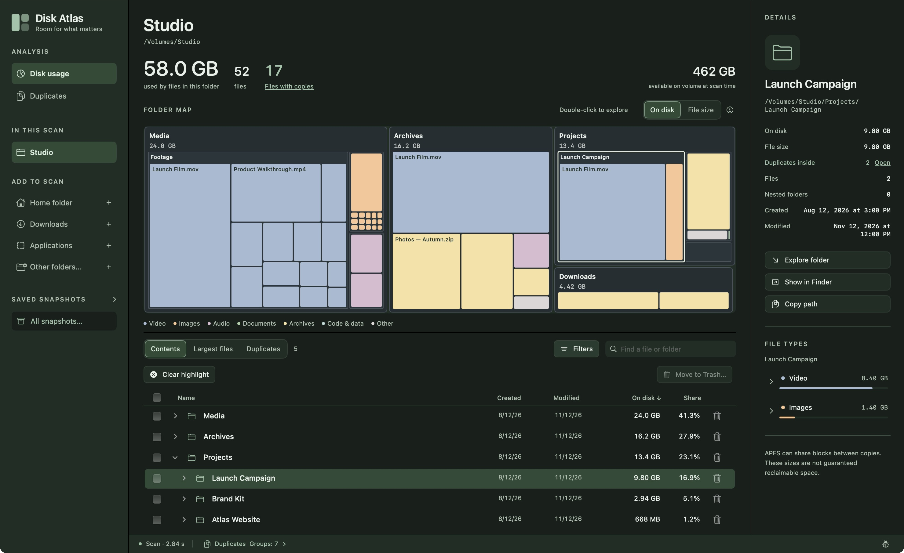
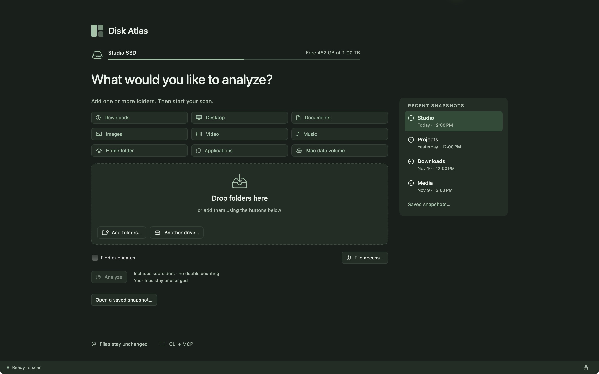
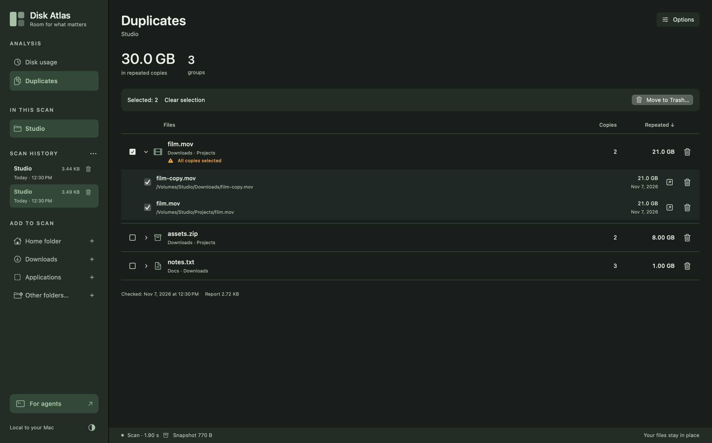
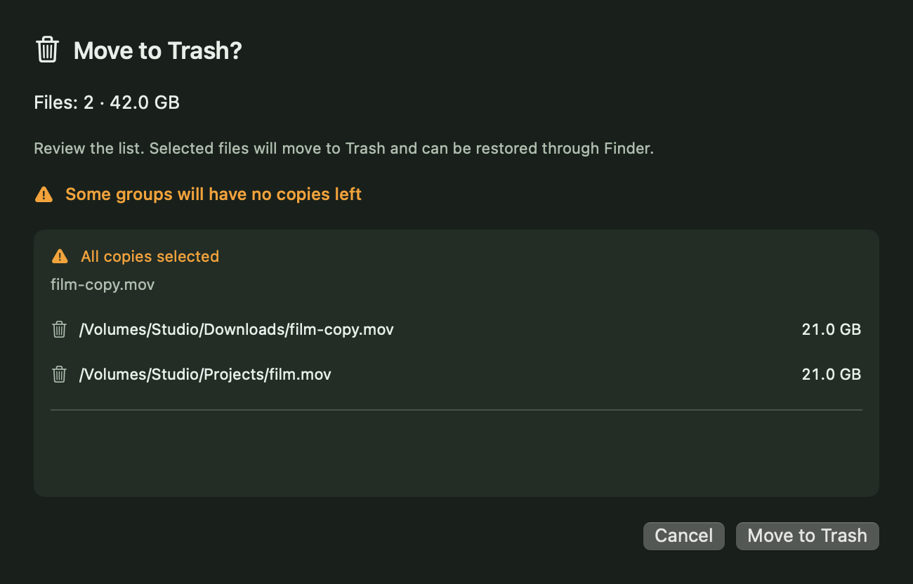

<div align="center">
  
  <h1>Disk Atlas</h1>
  <p><strong>Room for what matters.</strong></p>
  <p>A native map of your Mac’s storage. Built for people and agents.</p>
  <p><a href="https://github.com/ai-babai/disk-atlas/releases">Download for macOS</a> · <a href="README.ru.md">По-русски</a> · <a href="docs/ARCHITECTURE.md">Architecture</a> · <a href="#contact">Contact</a></p>
  <p>macOS 14+ · Apple Silicon & Intel · English / Русский · Early access</p>
</div>

**Looking for WinDirStat for Mac?** Disk Atlas is a free, open-source **disk space
analyzer for macOS**: a native WinDirStat alternative for Mac with an interactive
storage treemap, expandable folder tree, large-file search and duplicate finder.
It supports Apple Silicon and Intel, with a GUI for people and a JSON CLI for agents.

If you use WinDirStat on Windows or are exploring alternatives to [DaisyDisk](https://daisydiskapp.com/) and
[GrandPerspective](https://grandperspectiv.sourceforge.net/) on macOS, Disk Atlas covers the visual disk-usage workflow with
local scan history and explicit, reviewed Move to Trash actions. It is an
independent project, not an official WinDirStat port.



*Native interface preview with illustrative data. Your files stay on your Mac.*

## Make space understandable

Choose what to analyze first. Add several folders, review the selection, then
start the scan. Explore the treemap, follow the largest folders, filter by type
or find an item by name. Open an earlier scan whenever you need to return to it.

- **A map and a real file list.** Allocated or logical sizes, scoped search,
  largest files, sortable dates and sizes, size/date view filters and a focused inspector.
- **Duplicates, on your terms.** An explicit background check, a cost estimate first,
  pause/stop controls and one-click access to confirmed copies from the file list.
- **Your scope, your choice.** Multiple folders, drag and drop, common locations,
  overlap detection and no scan until you press Analyze.
- **History that remembers.** Local compressed results, dates and sizes; opening
  a snapshot does not rescan its folders. Reading and map preparation have visible stages.
- **Native comfort.** Smooth native pane transitions preserve dragged widths and honor Reduce Motion. Resizable and collapsible sidebars, one compact toolbar,
  light/dark themes and English/Russian UI, with a compact language menu in the
  toolbar. Double-click a file to reveal it in Finder.
- **The same data for agents.** CLI, JSON output and an MCP server share the scan core.

The start screen shows the startup volume’s name, free space and total capacity
without scanning files. Returning Home keeps the current snapshot in memory;
the Back arrow or its history entry restores it immediately. Inspector width is
remembered after resizing, hiding and returning from Home.

Contents is a native outline: open several folder levels with disclosure arrows,
or use Left/Right on a selected row. Children come from the existing snapshot,
not another disk scan. Large branches show 1,000 items at a time with **Show more**.
Search and Largest files remain flat lists. Compact selection controls keep the
table in place when you check Trash candidates.

## Download & install

1. Open [Releases](https://github.com/ai-babai/disk-atlas/releases).
2. Download **Disk-Atlas-0.14.5-universal.dmg**. The same app supports Apple Silicon
   and Intel Macs running **macOS 14 Sonoma or later**.
3. Open the DMG and drag **Disk Atlas.app** to **Applications**. Eject the image,
   then launch the app from Applications. A ZIP is also available.

This ordinary build is **ad hoc signed and not notarized by Apple**. On another
Mac, Gatekeeper may block the first launch. After verifying the download source,
follow [Apple’s instructions](https://support.apple.com/102445): attempt to open
it, then check **System Settings → Privacy & Security → Open Anyway**. Do not
turn off Gatekeeper globally. A paid Apple Developer membership is not required
to build this version; a notarized distribution would need a Developer ID setup.

Optional integrity check, with both downloaded artifacts beside the checksum file:

```sh
shasum -a 256 -c SHA256SUMS.txt
```



## A quiet, deliberate workflow

1. **Choose folders.** Drop folders, use the multiple-selection picker or quick locations.
2. **Analyze.** See progress and stop when needed. Cancelling a new scan keeps the previous result.
3. **Explore.** Single-click to select; expand folder arrows in Contents to browse inline without changing the map. Double-click a folder to go inside or a file to reveal it in Finder.
4. **Return later.** Use scan history, or export a portable `.atlas` snapshot.

| Shortcut | Action |
| --- | --- |
| ⌘N / ⌘O | New scan / open snapshot |
| ⌘F / ⌥⌘F / ⌘, | Find in the active list / Settings |
| ⌘S / ⌘R / ⌘. | Export / rescan / stop |
| ⌘↑ / Return | Go up / explore folder or reveal file |
| Space / Esc | Quick Look for the focused file / close preview |
| ⌘[ | Return from Home to the current snapshot |
| ⌘B / ⌥⌘I | Toggle navigation / inspector |
| ⇧⌘C | Copy the current scope as agent-friendly JSON |

The folder map stays visible in **Disk usage**. Use **Contents / Largest files**
directly above the list to switch between immediate contents and files throughout
the current folder. Search, type filters and selection stay in place. Selecting a
row outlines its location on the map, or the nearest visible containing folder or
grouped area, without changing the map scale. Drag the divider below the map to allocate more height to the list. Resize column headers, use Shift-click for checkbox ranges, and choose secondary columns in Settings. Click a column heading to sort
by name, creation date, modification date, size or share; click again to reverse.
The **Filters** button above the map affects both the map and list,
without changing the saved scan. Its two-handle slider supports presets and exact
bounds. Size criteria always use logical file bytes. Reset restores the full scan.

The list renders up to 1,000 matches and shows the total count. Search and type
filters affect the list; the map keeps showing the whole current folder. Click any
category name to toggle it. The disclosure arrow shows extensions with their size
and file count; choose one to narrow the list, including files with no extension.
Several categories can be selected together;
**All** or the compact filter badge clears the selection. Search narrows the selected types. Missing
creation dates are omitted from the inspector, and the column hides when no
visible row has that date. Dates describe the time of the scan, not live changes.

Click a **More** area to show its contents in the list without zooming or navigating.
Use **Clear highlight** below the map or click empty workspace background to clear
the selection and temporary More scope. Search, type filters and Contents / Largest
files mode stay unchanged. Trash checkboxes are independent.

File-list checkboxes select items for Trash independently of the focused row.
Use the fixed action bar for all checked items, or the Trash icon in a row for one
item. Both file-list and duplicate bars show the checked count and total size.
Ordinary totals follow the size toggle and include complete folders without counting
selected children twice. Duplicate totals include the content size of every checked
copy, without promising equivalent reclaimed APFS space.
The header checkbox selects the displayed rows. Every move requires a
full-path review; folders include their contents and overlapping child selections
are merged. Changed/unavailable items stop the operation. Moves use recoverable
macOS Trash, never permanent deletion. The current map/list and saved duplicate
report are reconciled; the original historical scan remains a snapshot of its scan time.

Press **Space** on a file row or choose **Quick Look** from its context menu.
The system panel previews supported formats and browses neighboring items with
arrow keys. Expanded duplicate groups also have an eye button; click a file name,
then Space to preview that copy. Checkboxes remain a separate selection for Trash.
Previews read the current file only on request; snapshots do not embed contents.
Unavailable or unsupported files use the system's own fallback presentation.

Allocated size (**On disk**) is the default. Use the direct **On disk / File size** switch
and its info button to understand the difference. A single map click selects the exact
file or folder for the inspector, including nested rectangles, without changing
the current directory. If the object is in the list below, the list scrolls to
it, including nested search matches, while preserving the search and type filters.
Direct children are included even outside the first 1,000 rows. A nested object
missing from the list appears as one temporary context row with its path, beside
the nearest visible ancestor (or at the top when no ancestor is listed). The
folder, filters and match count stay unchanged; the next map selection replaces
that context row. Click the sidebar logo to return to the empty start screen;
saved history remains available. Double-click a
folder or choose **Explore folder** to enter it. Aggregated **More…** tiles reveal their contents in the list.

## Check duplicates when you need them

Duplicate checking is **off by default** and separate from the storage map.

1. Select **Find duplicates** before scanning. Size presets and the range slider
   appear immediately. Checking may take time; when the storage map is ready, the
   background check starts automatically. There is no second Start button.
2. The lower status strip shows the phase, time estimate and pause/stop controls.
   The map and list remain usable. Duplicate checking covers all dates.
3. Sort groups by repeated bytes, copy size, copy count or name; click a column heading
   to reverse its order. Expand a group to compare locations and reveal a copy in Finder. A small copies
   icon beside a known file opens its exact group, without checking again.

For an existing scan that was not opted in, open **Duplicates**, review the
candidates and read/time estimate, then press **Start comparison**. **Options**
contains size bounds and optional file types.

After a check, **Filters** applies size and type criteria to the saved results
without reading files again. Resetting or widening these filters within the
original checked scope restores those results. Every matching group keeps all
its copies visible, including copies with another extension or outside the
selected folder. Filtering clears Trash selection so hidden choices cannot be
carried into cleanup.

A limited or stopped check is labelled **Only checked files are shown** when the
view asks for more than was checked. **New check…** is separate: choose its scope,
review an estimate, then explicitly start content comparison. Cancelling its
options leaves the saved report intact. Reports reopen with history; filters do
not replace them. The overview’s underlined **Files with copies** metric opens duplicates.



Different sizes are never compared. The checker samples the first and last 64 KiB.
For exactly two surviving large files it goes straight to byte comparison,
skipping a redundant full-file hash pass. Larger candidate buckets use fast
**XXH3-128** fingerprints, then byte verification; fingerprint collisions are
partitioned by actual content. Files up to 1 MiB use one full fingerprint instead
of an extra sampling pass. [Measured changes and dependency provenance](docs/PERFORMANCE.md#duplicate-checking-in-080).
Hard-link aliases count once; symlinks, special files and cloud-only placeholders
are skipped. Changed or replaced files are rejected.

Time estimates are broad planning ranges, not benchmarks: drive speed, file count
and matching content affect the result. The GUI compares files of any age;
advanced date criteria remain available through CLI/MCP. A check uses files known
to the source scan; rescan to include newly added files. Results carry their check
date and can become stale. Stopping preserves confirmed groups as a partial report.
Stop is available during checking, indexing and report saving; cancellation keeps
the previous saved report intact until a new complete atomic write. Quitting
interrupts background work without waiting indefinitely. Unsaved current results
may be lost; existing history is retained.

Checkboxes select copies for **Trash**. A group checkbox selects **every copy**. Individual checkboxes have no hidden
keep-one restriction. Fully selected groups show **All copies selected**, even
when collapsed, and the review warns that no copy will remain. Row/group trash buttons
and the selection bar always open a review listing every selected path and any
remaining copies. After confirmation, the GUI rechecks contents in the background,
checks identities again, then moves files to macOS Trash. It never permanently
deletes them or falls back to deletion if Trash fails. Stop preserves already
moved files in Trash; changed/unavailable files abort the operation. Finder can
restore trashed files. Rescan to update the dated storage map. Repeated logical
bytes are not guaranteed reclaimable APFS space.

The overview and folder inspector link to confirmed copies within that folder;
no empty duplicate badge is shown before a result. Sort using table headings.
The info button beside the size switch explains allocated blocks versus content length.



## For agents

The CLI is the primary agent interface. No MCP setup is required. Install the app,
then link its bundled command (use the app's actual installation path):

```sh
"/Applications/Disk Atlas.app/Contents/MacOS/disk-atlas" install
disk-atlas doctor
disk-atlas schema inspect
disk-atlas history list --json
disk-atlas history inspect latest --files --limit 20 --json
```

For a new scan: `disk-atlas scan ~/Downloads --output scan.atlas --json`.
Duplicate estimates read only metadata; `duplicates --read-contents` explicitly
authorizes comparison. JSON is automatic when piped, lists are bounded, and
progress/errors use stderr. Ctrl-C stops work. There are no CLI cleanup commands.

[CLI guide and contract](docs/CLI.md) · [Русская версия](docs/CLI.ru.md).
A standalone universal CLI ZIP is also available in Releases. The GUI's **For
agents** sheet copies CLI commands; optional MCP configuration is collapsed below.
MCP still provides the five existing stdio tools without a network listener;
per-request MCP progress/cancellation are not implemented.

## Local by design

Ordinary scans and duplicate preparation read **metadata**. Only the separate
opt-in duplicate check reads file contents, locally. The scanner includes hidden files and application packages,
does not follow symlinks, and counts hard links once across selected roots. It
has no deletion, moving, content execution, networking or privilege escalation
operations. Protected directories can be skipped and appear in the issue list.

- **On disk:** allocated blocks reported by `lstat.st_blocks × 512`.
- **File size:** logical bytes reported by `lstat.st_size`.
- APFS clones, shared blocks, snapshots and purgeable space mean these values
  are **not guaranteed reclaimable space**. Folder metadata blocks are excluded.
- This is a scan over time, not an atomic filesystem snapshot; changing files
  can affect totals. The first 200 read errors are retained.

**Saved snapshots…** opens a separate window with compressed snapshot sizes,
duplicate-report sizes and total history storage. These are saved metadata sizes,
not the sizes of source folders. Recent snapshots on Home show only name/date.
In the sidebar, Add to scan comes first; Saved snapshots starts collapsed, with an
explicit All snapshots button. Expanding it shows snapshot weights and delete
buttons. The whole section heading toggles the list. In the snapshots window,
a row click only selects it; use Open to restore it without scanning again.

History is stored in `~/Library/Application Support/Disk Atlas/History`, compressed
with LZFSE; duplicate reports are separate JSON metadata files. The directory uses mode 0700 and files use 0600. Old history is not
pruned automatically. Delete one snapshot with its trash button in **Saved snapshots**, or use **Clear history**
to remove all app-owned snapshots and metadata, including duplicate reports. A confirmation includes **Don’t ask
again**; turn confirmations back on in the history window. Deleting history never
deletes source files or separately exported snapshots. GUI history and requested exports are local writes; scanned
source files remain untouched by scans/history cleanup; only the separately confirmed GUI Trash action moves copies. Exported snapshots and duplicate reports contain **private paths and names**:
review them before sharing. Imports validate structure and totals, up to 2 GiB.

Performance measurements and their limits: [PERFORMANCE.md](docs/PERFORMANCE.md).

### Optional macOS file access

Disk Atlas works with ordinary macOS folder permission prompts. Allow or deny them
as needed; skipped folders are listed instead of counted as empty. **File access…**
in scan setup and skipped-path details explains optional **System Settings → Privacy
& Security → Full Disk Access**. You can add Disk Atlas there to reduce separate
prompts, or leave it off. The app never grants or requires this permission.
Full Disk Access is a broad system permission, not a read-only entitlement; revoke
it in the same settings. Restart and rescan after changing access. An app update
may require permission again, particularly with this ad hoc signed distribution.
[Apple explains the permission boundary](https://developer.apple.com/documentation/security/accessing-files-from-the-macos-app-sandbox).

## Build from source

Builds use Xcode 16.4 / Swift 6.1.2. SwiftPM fetches the pinned Swift Argument Parser 1.8.2 dependency; hashing is vendored locally. See [QUALITY.md](docs/QUALITY.md) for contributor tooling.

```sh
git clone https://github.com/ai-babai/disk-atlas.git
cd disk-atlas
scripts/build.sh --install
```

The local installer uses `~/Applications` and adds `~/.local/bin/disk-atlas` if
that name is free. Quit the running app before replacing its bundle.

```sh
scripts/release.sh
```

Builds arm64 and x86_64 executables, combines them into a universal app, verifies
the ad hoc signature, and creates DMG, ZIP and SHA-256 files in `dist/release/`.
See [architecture and validation](docs/ARCHITECTURE.md), [changelog](CHANGELOG.md)
and [security policy](SECURITY.md). Contributors share [one quality gate](docs/QUALITY.md): strict formatting/build,
behavior and generated-property tests, coverage/CRAP, complexity and selected
mutations, including checks of the maintenance scripts themselves. Run `scripts/setup-dev.sh`, then `scripts/check.sh`. Its scope and
frozen pre-existing complexity debt are explicit. Native UI review remains required.

---

## Contact

Author: **Maksim Popkov** · [GitHub repository](https://github.com/ai-babai/disk-atlas).

For questions, feedback or collaboration, contact the author:

- Telegram: [@SkifMax](https://t.me/SkifMax)
- Email: [wip.maks.craft@yandex.com](mailto:wip.maks.craft@yandex.com)

For reproducible bugs, [open an issue](https://github.com/ai-babai/disk-atlas/issues). For security reports, follow the [security policy](SECURITY.md).

---

Independent software inspired by the local-first, human-and-agent workflow of
[Artcraft](https://getartcraft.com/). Not affiliated with Artcraft or WinDirStat.
Open source under the [MIT License](LICENSE).

Duplicate name/path search covers every confirmed group in the saved index. Use
**Show 500 more groups** to continue browsing; filtering/searching never rereads
source contents. The original report and its coverage remain unchanged.
