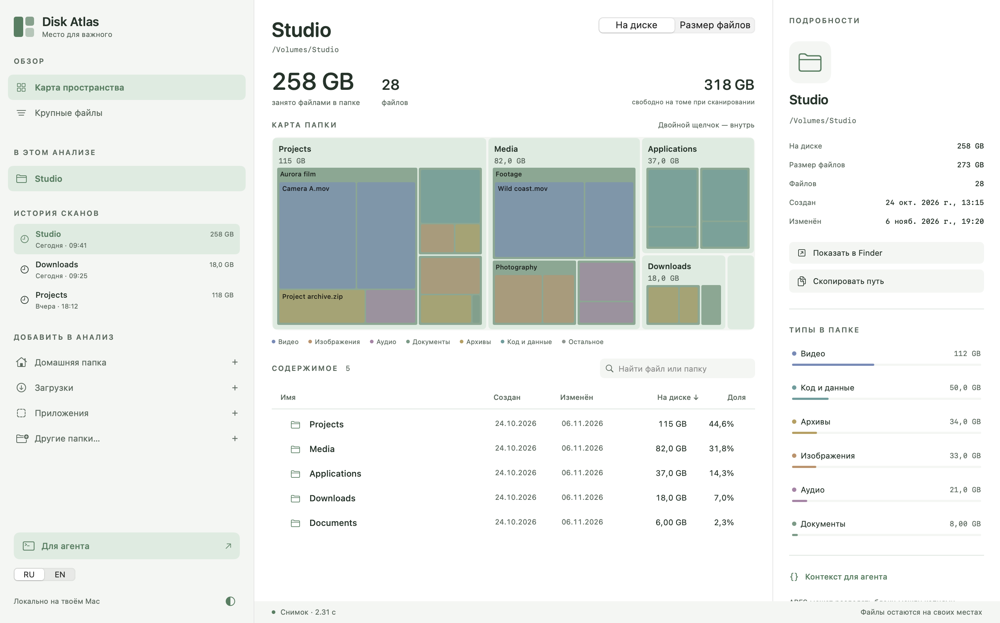
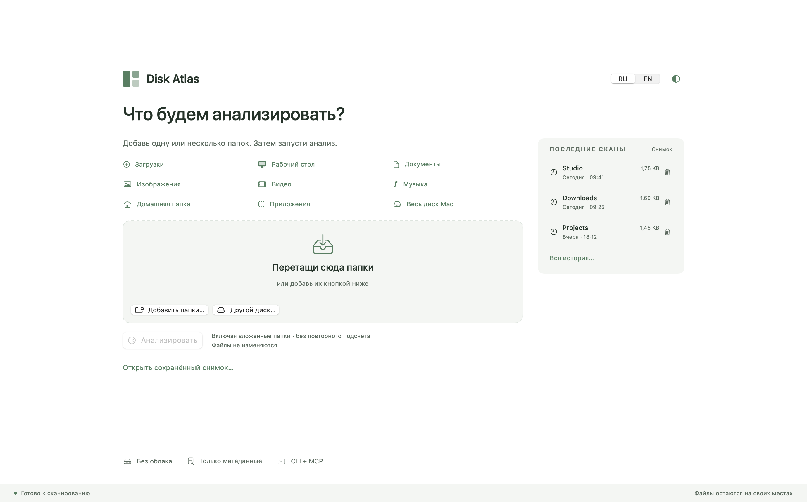
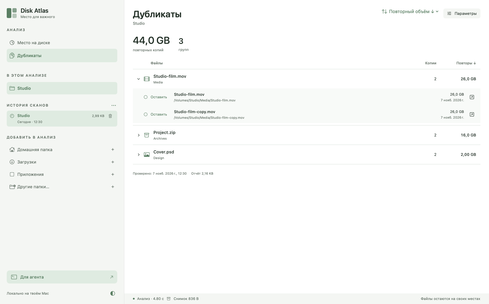
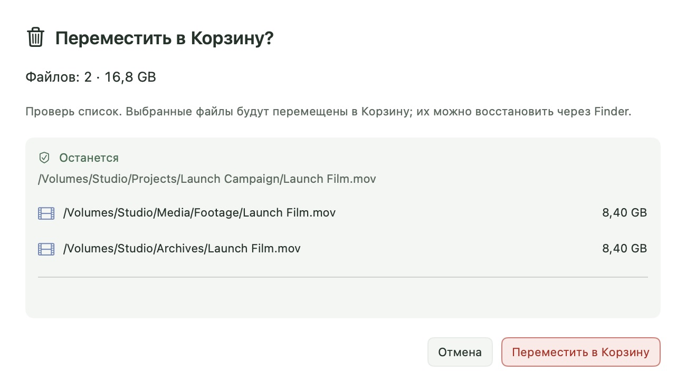
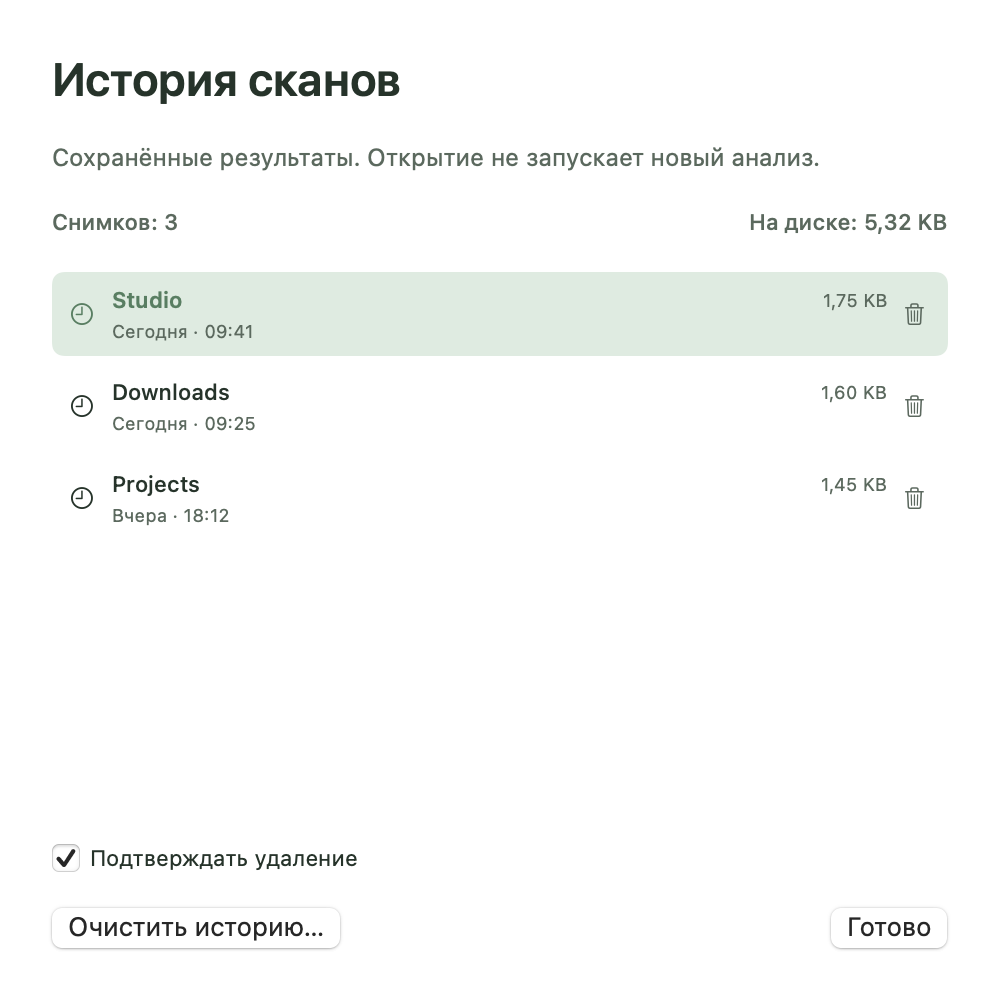

<div align="center">
  
  <h1>Disk Atlas</h1>
  <p><strong>Место для важного.</strong></p>
  <p>Нативная карта занятого места на Mac — для человека и агента.</p>
  <p><a href="https://github.com/ai-babai/disk-atlas/releases">Скачать для macOS</a> · <a href="README.md">English</a> · <a href="docs/ARCHITECTURE.md">Архитектура</a> · <a href="#контакты">Контакты</a></p>
  <p>macOS 14+ · Apple Silicon и Intel · English / Русский · Ранний доступ</p>
</div>



*Интерфейс показан на вымышленных данных. Твои файлы остаются на Mac.*

## Понять, куда уходит место

Сначала выбери, что анализировать: добавь несколько папок, проверь список и запусти
сканирование. Исследуй карту, открывай крупные папки, фильтруй типы или ищи по имени.
К предыдущему результату можно вернуться через историю.

- **Карта и полноценный список.** Занятые блоки или размер данных, поиск внутри
  области, сортировка по датам и размеру, фильтры карты по размеру/дате и инспектор.
- **Дубликаты по запросу.** Отдельная фоновая проверка с предварительной оценкой,
  паузой и остановкой. Значок у файла открывает все подтверждённые копии.
- **Управляемая область.** Несколько папок, перетаскивание, системный выбор,
  типовые места и объединение пересекающихся путей. Анализ начинается отдельной кнопкой.
- **История сканов.** Локальные сжатые результаты с датой и объёмом. При открытии
  папки не сканируются заново; чтение и подготовка карты показываются явно.
- **Нативное удобство.** Боковые панели скрываются и меняют ширину, сверху одна
  компактная панель. Две темы, RU/EN. Двойной щелчок по файлу выделяет его в Finder.
- **Те же данные для агента.** CLI, JSON и MCP используют общее ядро сканирования.

На главной сразу видны название системного тома, свободное место и общая ёмкость —
без сканирования файлов. Переход домой сохраняет текущий снимок в памяти; стрелка
назад или та же запись истории возвращает его сразу. Ширина инспектора сохраняется
после перетаскивания разделителя, скрытия и возврата с главной.

## Скачать и установить

1. Открой [Releases](https://github.com/ai-babai/disk-atlas/releases).
2. Скачай **Disk-Atlas-0.11.1-universal.dmg**. Одна сборка подходит для Apple Silicon
   и Intel с **macOS 14 Sonoma или новее**.
3. Открой DMG, перетащи **Disk Atlas.app** в **Applications («Программы»)**,
   извлеки образ и запусти приложение из «Программ». Также доступен ZIP.

Это обычная сборка с **подписью ad hoc, без нотарификации Apple**. На другом Mac
Gatekeeper может заблокировать первый запуск. Проверь источник и следуй
[инструкции Apple](https://support.apple.com/102445): попробуй открыть приложение,
затем проверь **Системные настройки → Конфиденциальность и безопасность → Всё равно открыть**.
Не отключай Gatekeeper целиком. Для этой сборки платное членство Apple Developer
не требуется; для нотарифицированного дистрибутива понадобится Developer ID.

Проверка целостности, если оба архива лежат рядом с файлом контрольных сумм:

```sh
shasum -a 256 -c SHA256SUMS.txt
```



## Спокойный, понятный сценарий

1. **Выбрать папки.** Перетащить, выбрать несколько в диалоге или добавить типовое место.
2. **Анализировать.** Видеть прогресс и при необходимости остановить. Отмена нового
   анализа сохраняет предыдущий результат.
3. **Исследовать.** Один щелчок выделяет объект; двойной открывает папку в анализе
   или выделяет файл в Finder.
4. **Вернуться позже.** Открыть запись истории или экспортировать снимок `.atlas`.

| Клавиши | Действие |
| --- | --- |
| ⌘O / ⇧⌘O | Новый анализ / открыть снимок |
| ⌘S / ⌘R / ⌘. | Экспорт / пересканирование / остановка |
| ⌘↑ / Return | Выше / открыть папку или выделить файл |
| Пробел / Esc | Quick Look выбранного файла / закрыть просмотр |
| ⌘[ | Вернуться с главной к текущему снимку |
| ⌘B / ⌥⌘I | Скрыть навигацию / инспектор |
| ⇧⌘C | Скопировать область в JSON для агента |

В разделе **«Место на диске»** карта видна постоянно. Переключатель
**«Содержимое / Крупные файлы»** прямо над списком меняет только его строки:
непосредственное содержимое или файлы во всей текущей папке. Поиск, типы и
выделение сохраняются. Выбор строки подсвечивает место объекта на карте — сам
объект, ближайшую видимую папку или общую область мелких объектов — без смены
масштаба. Нажатие на
заголовок колонки сортирует по имени, созданию, изменению, размеру или доле; повторное
меняет направление. Кнопка **«Фильтры»** над картой действует на карту и список.
Диапазон задаётся двумя ручками, пресетами или точными значениями; используется
логический размер файлов. Сброс возвращает весь анализ, сохранённый снимок не меняется.

Список отображает первые 1 000 совпадений и полный счётчик. Поиск и типы фильтруют
список; карта показывает текущую папку целиком. Неизвестная дата создания не
показывается в инспекторе, а колонка скрывается, если таких дат нет в видимых
строках. Даты соответствуют скану, а не текущим изменениям файлов.

Нажми на область **«Ещё N»**, чтобы увидеть её состав в списке без изменения
масштаба и папки. **«Снять выделение»** под картой или щелчок по свободному фону
убирает выделение и временную группу. Папка, поиск, типы и режим списка сохраняются.
Галочки Корзины остаются независимыми.

Галочки списка выбирают объекты для Корзины отдельно от обычного выделения.
Постоянная панель переносит все отмеченные объекты, значок в строке — один.
Галочка заголовка выбирает показанные строки. Перед каждым переносом нужно
проверить полные пути: папки перемещаются со всем содержимым, вложенные отметки
объединяются с выбранной родительской папкой. Изменившиеся или недоступные объекты
останавливают операцию. Используется восстановимая системная Корзина. Текущая
карта/список и сохранённый отчёт дубликатов обновляются; архив исходного анализа
сохраняет состояние на момент сканирования.

Нажми **Пробел** на строке файла или выбери **«Быстрый просмотр»** в её меню.
Системное окно показывает поддерживаемые форматы; стрелки переключают соседние
объекты. В раскрытой группе дубликатов есть кнопка с глазом; щелчок по имени и
Пробел открывают конкретную копию. Галочки отдельно выбирают файлы для Корзины.
Просмотр читает текущий файл только по запросу; содержимое не хранится в снимке.
Для недоступного или неподдерживаемого файла отображение определяет сама macOS.

Нажатие в любой части строки типа — включая полосу — включает или выключает его.
Можно выбрать несколько типов; «Все» или компактный индикатор над списком сбрасывает
выбор. Поиск уточняет выбранные типы, карта сохраняет полный обзор папки.

По умолчанию показан размер **«На диске»**. Логический **«Размер файлов»** доступен
в прямом переключателе **«На диске / Размер файлов»**. Значок info рядом поясняет различие.
Один щелчок по карте выделяет конкретный файл
или папку, в том числе вложенную, и показывает подробности без перехода в другую
папку. Если объект есть в списке снизу, список прокручивается к нему — в том
числе к вложенному совпадению поиска, сохраняя запрос и выбранные типы. Прямые
дети попадают в список, даже если были за первыми 1 000 строк. Если вложенного
объекта в списке нет, для него появляется одна временная строка с путём — рядом
с видимым предком или в начале списка. Папка, фильтры и счётчик совпадений
сохраняются; следующий выбор на карте заменяет эту строку. Логотип в sidebar
возвращает на пустой стартовый экран; история остаётся доступна. Для входа в папку нужен двойной
щелчок или **«Исследовать папку»**. Серая область **«Ещё…»** показывает свой состав в списке.

## Дубликаты — когда они нужны

Проверка **выключена по умолчанию** и отделена от карты места.

1. Отметь **«Найти дубликаты»** перед анализом. Пресеты размера и диапазон появятся
   сразу. Сначала считаются размеры файлов; затем поиск дубликатов запускается в фоне
   автоматически и может занять время. Второй кнопки «Начать» нет.
2. Нижняя строка показывает фазу, оценку времени, паузу и остановку. Карта и список
   доступны во время проверки. Сравниваются файлы за любые даты.
3. Отсортируй группы по повторному объёму, размеру копии, числу копий или имени;
   заголовок колонки меняет направление. Раскрой группу и посмотри расположение копий; файл можно выделить в Finder.
   Значок копий возле имени в списке открывает нужную группу без новой проверки.

Если поиск не был выбран перед анализом, открой **«Дубликаты»**, посмотри кандидатов
и оценку чтения/времени, затем нажми **«Начать проверку»**. В **«Параметрах»** —
размер и необязательные типы файлов.

После проверки кнопка **«Фильтры»** отбирает сохранённые результаты по размеру и
типам без повторного чтения файлов. Сброс и расширение фильтров в пределах
проверенной области возвращают прежние группы. У подходящей группы остаются
видны все копии, включая другое расширение и расположение вне выбранной папки.
Смена фильтра снимает выбор для Корзины, чтобы не переносить скрытые отметки
в очистку.

Если исходная проверка была ограничена или остановлена, при выходе за её границы
появляется **«Показаны только проверенные файлы»**. **«Новая проверка…»** — отдельное
действие: выбрать область, оценить время, затем явно запустить чтение. Отмена
параметров сохраняет готовый отчёт. Он открывается вместе с историей, фильтры
его не заменяют. Подчёркнутая метрика **«Файлов с копиями»** в обзоре открывает дубликаты.



Разные размеры не сравниваются. Сначала проверяются первые и последние 64 КиБ.
Если осталось ровно два больших файла, они сразу сравниваются побайтно, без
лишнего полного прохода хеширования. Для больших групп кандидатов используется
быстрый **XXH3-128**, затем побайтное подтверждение; коллизии разделяются по
содержимому. Для файлов до 1 МиБ сразу считается полный отпечаток, без лишнего
прохода. [Замеры и источник зависимости](docs/PERFORMANCE.md#duplicate-checking-in-080).
Hard links считаются один раз; ссылки, специальные и облачные файлы без локального
содержимого пропускаются. Изменившиеся или подменённые файлы исключаются.

Оценка времени приблизительная: результат зависит от диска, числа файлов и
совпадений. В GUI возраст файлов не ограничивается; дополнительные критерии даты
сохранены в CLI/MCP. Используются файлы, известные исходному скану;
для новых файлов повтори обычный анализ. У результата есть дата проверки, со
временем он может устареть. Остановка сохраняет подтверждённые группы с отметкой
неполного результата.

Остановка доступна при чтении, индексации и сохранении отчёта. Отмена сохраняет
предыдущую записанную версию до новой завершённой атомарной записи. Выход прерывает
фоновые задачи без бесконечного ожидания; текущий несохранённый результат может
потеряться, история остаётся.

Галочки выбирают копии **для Корзины**. Галочка группы выбирает **все копии**. Любую галочку внутри можно поставить
или снять без скрытого ограничения «оставить одну». Полный выбор отмечен
индикатором **«Все копии выбраны»**, даже в свёрнутой строке; предупреждение
повторяется в подтверждении. Кнопки строки/группы
и общая кнопка всегда открывают список полных путей и оставляемые копии, если они есть. Только после подтверждения GUI заново сравнивает содержимое в фоне,
сверяет идентичность файлов и переносит их в системную Корзину. Безвозвратного
удаления и обхода ошибки Корзины нет. Остановка оставляет уже перемещённые файлы
в Корзине; изменённые/недоступные файлы прерывают операцию. Файлы можно восстановить
через Finder. Для актуальных размеров на датированной карте повтори анализ.
Повторный объём не обещает столько же свободного места на APFS.

В обзоре и подробностях папки есть переход к подтверждённым копиям внутри неё;
пустой счётчик не показывается. Сортировка — в заголовках таблицы. Info возле
«Размера» объясняет выделенные блоки и длину содержимого.



## Для агента

Основной интерфейс для агента — CLI, без настройки MCP. После установки приложения
добавь команду в PATH (укажи фактический путь приложения):

```sh
"/Applications/Disk Atlas.app/Contents/MacOS/disk-atlas" install
disk-atlas doctor
disk-atlas schema inspect
disk-atlas history list --json
disk-atlas history inspect latest --files --limit 20 --json
```

Новый анализ: `disk-atlas scan ~/Downloads --output scan.atlas --json`.
Оценка дубликатов читает метаданные; `duplicates --read-contents` отдельно разрешает
сравнение содержимого. В конвейере автоматически выдаётся JSON, списки ограничены,
прогресс и ошибки идут в stderr. Ctrl-C останавливает работу. Команд очистки в CLI нет.

[Руководство и контракт CLI](docs/CLI.ru.md) · [English](docs/CLI.md).
В релизах есть и отдельный универсальный CLI ZIP. Кнопка **«Для агента»** в GUI
копирует CLI-команды; необязательная конфигурация MCP свёрнута ниже. MCP сохраняет
пять инструментов stdio без сетевого порта; прогресс/отмена отдельных MCP-запросов
пока не реализованы.

## Локально и бережно

Обычный анализ и подготовка поиска читают **метаданные**. Содержимое файлов читает
только выбранная тобой проверка дубликатов, локально. Сканер включает скрытые файлы и содержимое пакетов приложений,
не обходит symlinks и учитывает hard links один раз между выбранными корнями.
Операций удаления, перемещения, запуска содержимого, сети и повышения прав нет.
Недоступные папки пропускаются и отображаются в списке ошибок.

- **На диске:** выделенные блоки `lstat.st_blocks × 512`.
- **Размер файлов:** логический объём `lstat.st_size`.
- Общие блоки APFS, clones, snapshots и purgeable space означают, что размер
  **не равен гарантированно освобождаемому месту**. Блоки метаданных папок исключены.
- Это обход во времени, а не атомарный снимок файловой системы: изменения во время
  скана могут влиять на итог. Сохраняются первые 200 ошибок чтения.

**«Снимок»** во время анализа показывает оценку метаданных до сжатия, а в нижней
строке готового результата — точный размер сжатого файла. Последние сканы видны прямо на старте.
У каждой записи есть размер снимка вместе с сохранённым отчётом дубликатов и кнопка удаления, а полное окно
истории также показывает общий объём на диске.



История хранится в `~/Library/Application Support/Disk Atlas/History`, сжатая LZFSE; отчёты дубликатов — отдельные JSON с метаданными.
Каталог имеет права 0700, файлы — 0600. Автоматического удаления старой истории пока
нет. Снимок можно удалить через контекстное меню, всю историю — кнопкой
**«Очистить историю»**. Удаляются записи и их метаданные, включая отчёты дубликатов. В подтверждении есть
**«Больше не спрашивать»**; запросы можно снова включить в окне истории. Исходные
файлы и отдельно экспортированные снимки не удаляются. История GUI и запрошенные экспорты — локальные записи; сканирование и очистка истории не меняют исходники. Отдельное подтверждённое действие GUI переносит копии в Корзину. В снимках и отчётах дубликатов есть **частные пути и имена**: проверяй их перед передачей.
Импорт проверяет структуру и итоги; ограничение JSON — 2 ГиБ.

Панели плавно сворачиваются нативной анимацией, сохраняют ширину и учитывают Reduce Motion.
Замеры и границы выводов: [PERFORMANCE.ru.md](docs/PERFORMANCE.ru.md).

## Сборка из исходников

Нужен Swift 6 / Xcode Command Line Tools на macOS. Внешних зависимостей нет.

```sh
git clone https://github.com/ai-babai/disk-atlas.git
cd disk-atlas
scripts/build.sh --install
```

Локальная установка использует `~/Applications` и добавляет `~/.local/bin/disk-atlas`,
если имя свободно. Перед заменой bundle закрой приложение.

```sh
scripts/release.sh
```

Скрипт собирает arm64 и x86_64, объединяет в universal app, проверяет подпись ad hoc
и создаёт DMG, ZIP и SHA-256 в `dist/release/`. См. [архитектуру и проверку](docs/ARCHITECTURE.md),
[историю изменений](CHANGELOG.md) и [политику безопасности](SECURITY.md).
Для контрибьюторов есть [единая проверка качества](docs/QUALITY.ru.md):
`scripts/setup-dev.sh`, затем `scripts/check.sh`. Скрипты обслуживания и их тесты
тоже входят в общий аудит. Формат, сборка, поведение,
generated properties, coverage/CRAP, сложность и выбранные мутации. Область
измерений и замороженный исходный долг указаны явно; нативный UI проверяется вручную.

---

## Контакты

По вопросам, предложениям и сотрудничеству пиши автору:

- Telegram: [@SkifMax](https://t.me/SkifMax)
- Почта: [wip.maks.craft@yandex.com](mailto:wip.maks.craft@yandex.com)

Для воспроизводимых ошибок есть [Issues](https://github.com/ai-babai/disk-atlas/issues). Об уязвимостях сообщай по [политике безопасности](SECURITY.md).

---

Самостоятельный проект, вдохновлённый локальной работой человека и агента в
[Artcraft](https://getartcraft.com/). Не связан с Artcraft или WinDirStat.
Открытый проект под [лицензией MIT](LICENSE).
