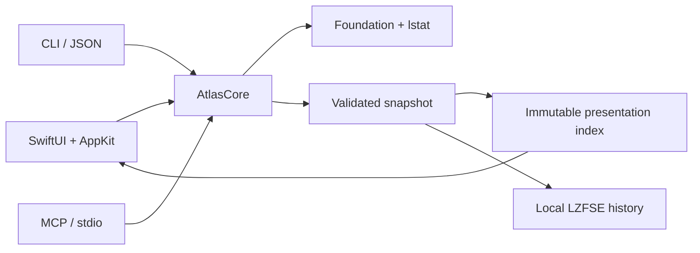

# Architecture

`AtlasCore` owns the scanner, snapshot format and presentation indexes. The GUI
uses SwiftUI for layout and a virtualized AppKit table for rows. CLI and MCP share
the scanner and JSON snapshot model; neither needs the GUI or a network listener.

## Data and safety

The scanner reads metadata with `lstat`, includes hidden files and application
packages, skips symlink traversal and stops at device boundaries. Hard links are
counted once across selected roots. Overlapping paths and APFS aliases are merged.
File names are untrusted data and are never evaluated as commands or instructions.

The scanner has no delete, move, cleanup, content execution or privilege escalation
operations. GUI history and explicitly requested snapshot exports are local writes.
CLI/MCP exports use exclusive creation and mode 0600. Imported snapshots validate
version, structure, cycles, connectedness, totals and integer overflow, up to 2 GiB.

Snapshots are observations over time, not atomic filesystem snapshots. macOS
permissions can exclude protected directories. APFS clones and shared blocks mean
allocated size is not a promise of reclaimable space.

## Rendering and storage

Scanning, snapshot decoding, compression and index construction run off the main
thread. The immutable index caches both size orderings, descendant ranges and type
totals. Filtered queries use a bounded top-K heap and cancellation checks. Only the
first 1,000 matches render; the full match count remains visible.

Treemap work is bounded by visible tile count, geometry and nesting depth. Small
objects are aggregated. The previous large index is retained through the visual
transition and released in a background task to reduce main-thread deallocation.

History stores lightweight records separately from LZFSE-compressed snapshots in
`~/Library/Application Support/Disk Atlas/History`. Directory mode is 0700; files
are 0600. Opening history never rescans source folders. Normal app termination
waits for an in-progress history write. History has no automatic pruning yet. Users can delete a snapshot or clear history
after the configured confirmation. Cleanup unlinks only UUID-named app archives
and the history manifest; source paths and exported snapshots are never targets.
The scanner maintains a cheap running estimate of uncompressed metadata; history
records report the exact compressed archive file size.

## Build and validation

Swift 6 / Xcode Command Line Tools, macOS 14+ deployment target, no external package
dependencies. `scripts/build.sh` builds locally; `scripts/release.sh` compiles arm64
and x86_64, combines executables, signs ad hoc and packages DMG/ZIP with checksums.

The initial release uses scratch validation outside the repository and manual UI
checks. No committed test suite or CI is included. An Intel slice can be built on
Apple Silicon, but this does not replace validation on physical Intel hardware.
