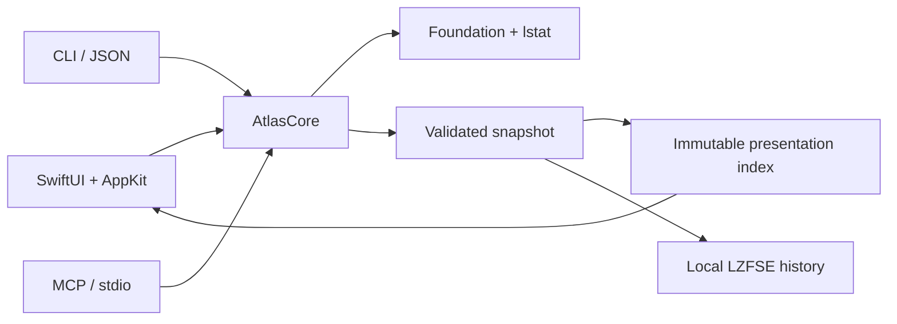

# Architecture

`AtlasCore` owns the scanner, snapshot format and presentation indexes. The GUI
uses SwiftUI for layout and a virtualized AppKit outline for file rows. CLI and MCP share
the scanner and JSON snapshot model; neither needs the GUI or a network listener.

CLI command declarations generate parsing and help through Swift Argument Parser.
`schema` exposes that same help in a compact effect catalog. Query DTOs omit internal
child arrays and fingerprints; scoped index queries retain only offset + limit
candidates. History commands load existing archives without source scans. One
foreground worker handles each CLI call, with a separate progress timer and
cooperative signal cancellation. See [CLI.md](CLI.md) for JSON and exit contracts.

## Data and safety

The scanner reads metadata with `lstat`, includes hidden files and application
packages, skips symlink traversal and stops at device boundaries. Hard links are
counted once across selected roots. Overlapping paths and APFS aliases are merged.
A synchronous thread-local no-materialization I/O policy covers root resolution and traversal; the prior policy is restored on return or failure. New entries retain optional dataless metadata. Branch facts are aggregated off-main; old snapshots keep cloud state unknown. File names are untrusted data and are never evaluated as commands or instructions.

The scanner has no delete, move, cleanup, content execution or privilege escalation
operations. GUI history and explicitly requested snapshot exports are local writes.
CLI/MCP exports use exclusive creation and mode 0600. Imported snapshots validate
version, structure, cycles, connectedness, totals and integer overflow, up to 2 GiB.

Snapshots are observations over time, not atomic filesystem snapshots. macOS
permissions can exclude protected directories. File access guidance is optional:
scan setup and skipped-path details link to System Settings, with explicit consent
left to macOS and the user. There is no TCC database access, protected-file probe,
automatic grant or mandatory Full Disk Access step. APFS clones and shared blocks mean
allocated size is not a promise of reclaimable space.

## Explicit duplicate checking

`DuplicateFinder.prepare` refreshes metadata for files known to a scan and groups
regular, locally available files by logical size. It does not read contents.
Options constrain size and type; date criteria retain groups with at least one
matching copy, including other-age peers. New paths need a fresh ordinary scan.

Only `run` reads contents: GUI opt-in before Analyze authorizes automatic
background start after the map is ready; an existing scan uses Start comparison.
CLI requires `--read-contents`, MCP requires `readContents: true`. The GUI has no
date restriction; CLI/MCP retain optional date criteria. Equal-size buckets first receive 64 KiB prefix/suffix
samples; files up to 1 MiB receive a complete XXH3-128 fingerprint once. Exactly
two large sample survivors bypass full hashing and go straight to byte comparison.
Other survivors are fully fingerprinted, then partitioned by actual byte equality
so a fingerprint collision cannot hide a distinct matching group. Buffers are at
most 1 MiB; reads bypass normal caching with `F_NOCACHE`. Files are opened with
`openat` and `O_NOFOLLOW` on every path component; the final descriptor also uses
`O_NONBLOCK`, and device/inode/size/mtime/ctime are checked before and after reads.
Cloud-only placeholders and nonregular files are skipped. There is no atomic
filesystem snapshot guarantee; reports are dated observations.

`DuplicateSession` is a separate observable model. Worker progress and partial
groups are batched, keeping updates out of the main map store. Pause and cancel
checkpoints occur between read chunks. Foreground scanning/indexing temporarily
pauses the background job. Confirmed groups survive stop as a partial report.
A path-to-group lookup is built off the main thread for file-list badges. Its
immutable `DuplicateResultIndex` retains confirmed groups; extension classification
is deferred until a type filter needs it, avoiding unnecessary work on load.
The cancellable ancestor-count index aggregates immediate parent counts first,
then propagates each distinct folder once, avoiding repeated ancestor URL walks.
Result filters are independent of `DuplicateSession.options`, which describe a
new content check. Size, kind and folder queries run on a cancellable worker and
never open source files, reset evidence or write the canonical report. A matching
copy supplies the group title; all its peers remain visible. Counts and repeated
bytes describe the full filtered set before the 500-group presentation limit.
Filter changes clear Trash selection. Saving/reloading the original report
preserves the evidence across launches; rebuilding this metadata index requires
no schema migration or source I/O.

Original size/kind/date coverage and partial-result flags bound completeness.
Widening a view beyond checked coverage displays an explicit notice instead of
claiming that unchecked files have no duplicates. A separate new-check sheet
estimates metadata cost before Start authorizes rereading contents. Cancelling
that sheet preserves the report. It does not implement an incremental hash cache
for future source checks; changed contents still require explicit revalidation.
Trash
selection marks mean Trash candidates. A mandatory review identifies selected paths and any unselected copies; fully selected groups are explicitly warned; confirmation starts off-main revalidation and native recoverable Trash moves. No permanent deletion or CLI/MCP cleanup exists. A check that finishes before its scan
archive is attached persists its report when the history UUID becomes available.

## Rendering and storage

`AtlasControls.swift` owns shared command surfaces and sliding mode selectors;
their states and usage are documented in [DESIGN.md](DESIGN.md). One list-mode
control remains mounted above both table bodies to retain keyboard focus and
selection animation. Layout placeholders reserve its space without exposing
duplicate controls to accessibility. Search-adjacent filters follow the active
list context; appearance sits beside Language in the native toolbar.

The map uses the opaque `MapPalette` colors in `Theme.swift`: lightened Tableau 10
category hues, three neutral folder surfaces, and a separate file-label foreground.
The light palette mixes 45% white into selected Tableau hues; the dark variant
adds 8% white. Folder depth never changes a file's category color. The map legend
and inspector composition bars share these fills. File icons retain their deeper
legible tints, and the app's green chrome and duplicate-focus accent stay separate.
Folder boundaries strengthen with Increase Contrast; nested folder labels follow
appearance while labels over the light file fills remain dark. Source palette:
[Tableau 10 / d3-scale-chromatic](https://github.com/d3/d3-scale-chromatic/blob/main/src/categorical/Tableau10.js).

The welcome screen reads startup volume name and filesystem capacity on a utility
worker; it does not walk directories or read contents. Capacity refreshes when
welcome appears, without polling. Home parks the current snapshot and selection
while retaining its existing presentation index and filters. Back (also ⌘[) and
reopening the active history entry restore this cached workspace without decoding
or scanning again. Applying another snapshot or deleting its history clears it.
The inspector toggle is the trailing toolbar action. Size mode is a direct
segmented control beside its info explanation; narrow workspaces wrap controls
onto two rows, and the file table scrolls horizontally when fixed columns cannot fit.

Scanning, snapshot decoding, compression and index construction run off the main
thread. The immutable index caches both size orderings, descendant ranges and type
totals. Filtered queries use a bounded top-K heap and cancellation checks. Only the
first 1,000 matches render; the full match count remains visible.

Size/date view filters construct a derived snapshot and index off the main thread;
the saved snapshot remains unchanged. Native range controls preview locally while
dragging and commit once on release. Table headers and cells share native column
geometry, with a trailing gutter for percentages. Nested canvas hit testing uses
the same bounded layout as drawing. A single map click selects the exact hit for
the inspector without changing the current directory, including nested folders
and files. Direct-child selections are included in the bounded list. Selecting
any already-listed match, including a nested search/type result, preserves its
filters and requests scrolling after native table layout. Scroll requests are
generation-checked and animate for 160 ms, or immediately under Reduce Motion.
In Contents without search/type filters, a stable NSOutlineView item pool projects
lazy child pages from the immutable index. Native disclosure/Left/Right expands
branches without navigation; child queries run off-main, with 1,000-item pages and
a continuation row. Source/sort changes cancel pending queries and reject stale
results. Expanded children support focus, Quick Look and independent Trash checks;
header checks target the currently revealed rows. Map hits expand their ancestor
chain and scroll to the actual item, including outside a branch's first page.
Accessibility capability queries have no expansion side effects. Search and Largest
files retain flat results. In these flat modes, missing nested hits are represented
by one extra context row, with its full path, after the nearest listed ancestor or at the top. This projection leaves the
folder’s bounded matches, ordering, filters and count intact. The next map hit
replaces the context row; navigation or filter changes clear it. AppKit computes
the scroll destination, including header insets, before the short animation. Aggregate
tiles select a temporary list group. Inspector content is constrained to its viewport width so long
paths cannot stretch or shift the panel.

The map remains above Contents, Largest files and Duplicates lists.
The segmented control sits with the list count and search, making its scope local;
it changes the lower list without navigating or replacing the index. Duplicate groups reuse
the current confirmed report and its metadata filters; entering that mode does not
start content comparison. The ordinary outline remains mounted beneath the duplicate
overlay to preserve expansion state and the split's fitting geometry.
The table viewport depends on window height, not mode or result count; fixed count
and status slots avoid shifting the map when only rows change. Narrow controls
wrap before the table. This follows [Apple’s segmented-control grouping guidance](https://developer.apple.com/design/human-interface-guidelines/segmented-controls)
and linked selection exemplified by [GrandPerspective](https://grandperspectiv.sourceforge.net/HelpDocumentation/NavigatingViews.html).

List-to-map highlighting follows snapshot parent IDs rather than path prefixes.
Only the selected branch is laid out, using the same child limits, depth and visible
interiors as painting. Stop at an exactly selected folder; otherwise outline the
deepest visible object, its nearest visible ancestor or an existing aggregate tile.
A zero-area file does not invent an aggregate area. Selection never changes scale,
current folder or filters. Core tests cover ancestry and scope boundaries; isolated
native QA checks exact nested rectangles, aggregates, deep fallback and mode state.

More areas capture the exact omitted child IDs at click time, including nested
aggregates. Their list scope shares the bounded RowQuery heap, filters and ordering
with ordinary results; no second index or source scan is needed. The persistent-height selection strip shows Clear highlight and the group label.
Clear highlight, empty workspace background and empty map gaps clear selection,
group scope and contextual rows without resetting folder/search/types/mode or
Trash checkboxes. Only background hit areas clear; child controls keep their own
clicks. Clearing also resets map double-click history. Navigation, size-basis and view
filter changes clear the group. Its inspector describes a collection, not a directory.

Ordinary file-list Trash uses independent checkboxes and fixed leading/trailing
native columns. Only available button cells update when checks change; row focus
and Quick Look stay separate. The shared Trash bar reserves 28 points in the compact
file header and 40 in duplicates, including with no checks. Both show count and total
size together. Ordinary totals use the original snapshot and active size metric off-main;
complete folders include their contents once, even when list filters hide children.
The review uses the same overlap normalization. Duplicate selection maintains its
content-byte total as paths are toggled, without traversing the report on every render.
Duplicate remaining-copy badges reserve their width, and streamed sorting leaves
existing results at full opacity with a fixed spinner slot.

FileTrashPlan normalizes folder/child overlap, validates scan scope and captures
current lstat identities for full-path review. Snapshot modification dates have
whole-second precision; review-to-move validation additionally compares nanosecond
mtime/ctime, device, inode, mode and the resolved parent path. Symlinks are moved
as links, not followed. The cancellable utility executor validates all items before
the first native Trash call and each item again before moving it; errors retain
partial results and never fall back to deletion. Folder moves include their whole
current contents. The current presentation prunes moved branches, remaps IDs and
restores the current folder by path, keeping export/reopen validation intact. It
rebuilds its index off-main and reconciles saved duplicate groups. Historical scan
archives remain historical. CLI/MCP expose no cleanup commands.

File tables and expanded duplicate groups use SwiftUI's native Quick Look panel.
Only an explicit Space/context-menu/eye action supplies a selected file URL;
no contents are prefetched or embedded in snapshots. Preview item collections are
bounded by the rendered list (1,000 files, or 200 copies in a group). Panel arrows
update table selection or duplicate-row focus, independently of Trash checkboxes.
A small AppKit key responder keeps Space local to a copy's label and restores it
after dismissal; text fields and Trash checkbox keys keep their own behavior.
Leaving the list or collapsing a duplicate group dismisses its preview. The system
owns format support, preview loading/animation and missing-file presentation.

Native NSSplitViewController items remain mounted when collapsed; their animator
moves the divider in 220 ms. The inspector uses a resizable generic split item
with a 210-point minimum and no fixed maximum, rather than AppKit’s fixed-width
inspector constructor. The workspace minimum naturally limits the divider to the
space available in the current window; the previous 460-point cap prevented
continued expansion in larger windows. The representable's `sizeThatFits` accepts
SwiftUI's finite proposal, including zero-size minimum probes, instead of feeding
the split controller's fitting size back into the surrounding hosting view. AppKit
remains responsible for column minima. This avoids outer sizing constraints that
outrank native divider drags and leave stale widths. See Apple's
[size proposal contract](https://developer.apple.com/documentation/swiftui/nsviewcontrollerrepresentable/sizethatfits(_:nsviewcontroller:context:))
and a comparable [native split integration](https://github.com/TableProApp/TablePro/blob/main/apple/TablePro/Views/Components/AutosavingSplitView.swift).
Regression review must physically drag the divider in both directions, inspect
content alignment after release, and repeat through collapse/show, Home/Back and
window resizing. Setting an accessibility divider value alone does not verify drag behavior. Separate AppKit autosave names retain navigation and inspector widths
after dragging, collapse and returning from Home. Each split item has an AppKit
container with four edge constraints around its SwiftUI hosting view, keeping
rendered content tied to the viewport. The native file-table scroll view requests
column layout when its frame size actually changes; an unchanged size does not
invalidate layout. This prevents stale intermediate column widths and layout loops.
See [Apple’s split controller layout contract](https://developer.apple.com/documentation/appkit/nssplitviewcontroller).
SwiftUI environment
values cross hosting boundaries, including Reduce Motion, appearance and disabled
state. Map state is isolated from unrelated observable-store updates; only the
selected branch invalidates nested Canvas artwork. Single clicks are immediate;
activation requires a second click on the same entry. Folder entry is explicit
through double-click, Explore folder or an Open action. The inspector's type
filter names the current list directory separately from the selected item.

Duplicate counts are precomputed per ancestor off-main. Folder links filter groups
off-main before sorting and bounding the visible results. DuplicateTrashPlan
requires valid scope, distinct file identities and unique selected paths. It records
remaining copies separately from a comparison reference. Every checkbox is
editable; selecting a group selects all its copies.
DuplicateTrashExecutor rechecks all selected byte pairs before the first move,
then revalidates reference/file metadata before each native Trash call. If every
copy is selected, the reference moves last; no keeper is silently imposed. Errors and
cancellation stop the batch, retain completed moves and update/persist only those
paths. A live filesystem still offers no atomic multi-file snapshot guarantee.

Treemap work is bounded by visible tile count, geometry and nesting depth. Small
objects are aggregated. The previous large index is retained through the visual
transition and released in a background task to reduce main-thread deallocation.

History stores lightweight records separately from LZFSE-compressed snapshots in
`~/Library/Application Support/Disk Atlas/History`. Directory mode is 0700; files
are 0600. Opening history never rescans source folders. Quitting cancels foreground/background jobs and terminates without waiting for
completion; a newly unsaved scan/report may be lost. Existing committed history
and reports remain available. History manifests and duplicate reports use atomic
replacement; cancellation checks before report commit and on every encoded file
keep the prior report intact when saving is cancelled. History has no automatic pruning yet. Users can delete a snapshot or clear history
after the configured confirmation. Cleanup unlinks only UUID-named app archives
and UUID-named duplicate-report JSON sidecars plus the history manifest; source paths and exported snapshots are never targets.
The scanner maintains a cheap running estimate of uncompressed metadata; history
records report compressed archive size plus the saved duplicate-report size.
Duplicate reports are limited to 256 MiB on read/write, use mode 0600, and are
removed together with the owning history record. Report encoding and index construction check cancellation; Stop remains available
while saving, with a Stopping state. Quitting may discard an unsaved partial result
rather than holding application exit indefinitely.

The native compact main toolbar uses the adaptive paper background across its width,
with borderless commands and shared secondary foreground colors. Its repeated app
title is hidden; the centered breadcrumb names the current location, shows at most
three components and supplies full-path hover help. Separators appear only between
visible components. Native window controls, dragging and overflow remain system-owned;
sidebar and inspector toggles stay at the leading and trailing edges respectively.
The custom navigation pane uses a regular collapsible NSSplitViewItem, like the
inspector. AppKit's sidebar-role item would create a separate titlebar section
and move the shared toolbar toggle with its divider. Explicit pane minimums,
collapse behavior, animations and width autosaving remain unchanged. The map
legend has 8 pt of bottom padding above the native map/list divider.

The shared 30-point status row observes duplicate updates separately from the map.
Its compact result button contains the duplicate label, state/count and chevron;
phase progress and pause/stop remain adjacent. The duplicate
overview metric underlines its existing Files with copies label, while inspector
metrics use an Open label rather than disclosure arrows, distinguishing
workspace navigation from group expansion ([Apple disclosure guidance](https://developer.apple.com/design/human-interface-guidelines/disclosure-controls)). The workspace status row shows scan/job state. The nonmodal Saved snapshots window uses palette-based storage cards and lightweight rows with explicit Open and delete actions. A row click changes local window selection only; only Open loads a snapshot. The history heading reuses SectionLabel typography and toggles across its entire width. Snapshot and duplicate-report weights remain separate. Home recent items carry only name/date. Sidebar Add to scan precedes Saved snapshots; history starts collapsed with a visible All snapshots button. Expanded recent rows show compressed snapshot weight and delete controls, reusing the existing confirmation flow. Optional notices truncate before job controls, preserving
the layout at the minimum window width. A decorative spinner is hidden from
accessibility so the result action keeps its button role.

## Build and validation

Swift 6 / Xcode Command Line Tools, macOS 14+ deployment target. The CLI statically links Apple Swift Argument Parser
1.8.2 (pinned with its lockfile and license). AtlasCore statically links vendored
xxHash 0.8.3 through CXXHash; its unmodified upstream header, source hash, BSD
license and audit boundary are documented in [PERFORMANCE.md](PERFORMANCE.md#duplicate-checking-in-080). `scripts/build.sh` builds locally; `scripts/release.sh` compiles arm64
and x86_64, combines executables and packages DMG/ZIP with checksums. Local signing
defaults to ad hoc; `ATLAS_SIGN_IDENTITY` selects Developer ID, with explicit inner
CLI → app → DMG signing. Official releases follow [RELEASING.md](RELEASING.md) to
notarize/staple the app before packaging and then the final DMG.

The project uses [the shared quality gate](QUALITY.md), behavior/property tests,
selected mutation checks and manual native UI validation. Complexity legacy debt
and the separate changed-Core and production-script coverage/CRAP scopes are reported explicitly.
Shell entry points are thin POSIX adapters. `scripts/build.py` owns packaging;
`scripts/quality` separates tool bootstrap, process orchestration, language adapters,
structural rules and coverage calculation. Their Python imports must remain acyclic.
Pinned tools live in a private ignored venv, and tooling tests live in `scripts/tests`.
The gate audits its own production code and tests rather than exempting them.
An Intel slice can be built on
Apple Silicon, but this does not replace validation on physical Intel hardware.

## 0.3.0 validation scope

Scratch checks exercise unequal-size/sample pruning, same-edge/different-middle
files, exact groups, date peers, hard links, symlink/path replacement, special
files, pause/resume, cancellation, view totals, sorting, report permissions and
history cleanup without source changes. Manual UI review covers EN/RU, both
themes, minimum window size, native headers, filters and badge-to-group navigation.
These checks are outside the repository; no durable test artifacts are added.

## Workspace and saved-analysis windows

The native vertical split between map and list remembers its divider position.
Contents/Largest files/Duplicates changes only the lower list. File rows allow native
column resizing; optional created/modified/share columns and appearance persist
in local preferences. Shift-click selects a checkbox range without changing the
single inspector/Quick Look focus. Settings uses the standard ⌘, command;
⌘F and ⌥⌘F focus the active list search, ⌘N prepares a new analysis, ⌘O opens a snapshot.

Confirmed duplicate queries run off-main against an immutable metadata index.
Unicode-folded paths are prepared once for repeated case/diacritic-insensitive
searches. Index construction and queries cooperate with cancellation. Search
input is debounced by 120 ms; generation checks reject stale results. The GUI
starts with 500 groups and can load further batches, preserving sort and source
context. Narrowing/clearing search never hashes source contents.

History and optional file-access guidance are independent, nonmodal windows,
sharing the same store/appearance. Storage management removes only app-owned
archives/reports under the existing confirmation setting. Source-file Trash still
requires its separate mandatory review. A source-picker sheet can open help
without creating a second sheet above itself.

## File types and extensions

Seven content categories keep the map legend compact. `FileFormat` classifies names only;
unknown/ambiguous `.raw` and `.ts` stay Other (`Docker.raw` is a known disk-image name).
Common camera, office, media, code, model and data formats are recognized. Functional
hints in the inspector identify application/library/VM packages without changing their
physical directory identity or counting their contents twice. These hints are not content verification.

Loading a version-1 snapshot validates structure/totals before refreshing regular-file
categories in memory. Links and directories keep their identity; archives on disk are not
rewritten. Duplicate filters use the same classifier. No type detection opens source files.

The inspector's existing category rows still filter the list. Their disclosure buttons
show extensions, bytes and file counts, including No extension. The extension summary
is computed off-main only for the expanded category, with cancellation and without a
per-directory extension cache. An extension narrows that category, combines with name
search, sort and size metric, and leaves map zoom intact. The filter chip and All clear it.
`inspect` and `history inspect` expose the same projection through `--extension png`
(or `--extension ''` for extensionless files). No new settings or map colors are added.

## Stable startup and list selection

Home waits for the initial lightweight history read before presenting its form, so
it uses the final one/two-column width from its first layout. A small progress
indicator covers this asynchronous bootstrap; errors still finish bootstrap. The
volume summary has a fixed 28 pt slot while capacity metadata arrives. No timer,
source scan or synchronous main-thread storage read is added.

The file-list header draws the same native AppKit switch cell as row checkboxes.
Its states are empty / mixed / checked, based only on displayed objects, and its
accessibility role/value expose that state. The default disclosure instruction is
removed; the reserved selection/action row keeps its height when selection changes.

## Duplicate list presentation

The embedded and full-report views share group/copy rows. `FileListMetrics` keeps
shared AppKit/SwiftUI fonts for names, paths, dates, sizes and headings, plus
native proportions: 33-point ordinary rows and a 43-point minimum for two-line
rows/groups. Duplicate paths wrap to their full height; checkboxes never change
that height. Group/copy icons and Trash review rows use the same `FileKind.symbol`
and `FileKind.tint` as ordinary file rows. Created/modified columns honor the same preferences as the ordinary
table, use numeric dates and show no fabricated group date. The embedded column
header stays fixed while copies scroll; narrow tables scroll horizontally.
`DuplicateOutline` uses the same AppKit `NSOutlineView` disclosure mechanism as
Contents. Its native scroll view reuses AppKit cells; group children are prepared
only when expanded and remain capped at 200 displayed copies. Native labels, icons and buttons share `FileListMetrics`, `AtlasRowView` and
`TrashTableCell` with Contents. No SwiftUI hosting view participates in row insertion,
opacity or offsets. Live expansion is cached without publishing a SwiftUI layout update.
Row heights use the actual native cell bounds and wrapping text-cell measurement,
and update on column/viewport changes. Existing native widths are not reassigned during disclosure. Stable
item identity preserves expansion; a new result index replaces stale metadata.
The full report keeps its controls and headings above the scrolling native rows.
Copy checks reuse the native row control and retain keyboard focus; Quick Look
URLs are built only when the user opens a preview. No content is prefetched.

Sorting and map-focus activity use reserved indicator slots, appearing only after
150 ms to avoid flashing during quick work. Existing rows stay in place during
background work. Map-focus completion is guarded by a selection generation, so a
cancelled or superseded job cannot clear a newer job's loading state.

Group focus, disclosure and Trash selection are independent in the embedded list.
Explicit group-row selection highlights the group; selecting a copy highlights only
that copy at the current map scale. Copy path labels remain ordinary wrapping text
so text-selection focus cannot hide them; Copy path remains in the row context menu.
Only an explicit row selection starts map highlighting; entering the mode,
restoring a requested group or expanding copies does not. Focus builds
ancestor copy counts on a cancellable metadata worker for the current presentation
index. Outlines are painted from the exact rectangles used by the tile painter,
inside their bounds, with a 1.5-point border. Up to 12 copies in the current folder
use their deepest visible locations. Larger groups use occupied top-level areas
with copy counts; if those exceed 12, one outline represents the current map
folder. The number of marks is bounded and no paths are searched per frame.
It never navigates automatically.
An explicit overview action returns to the snapshot root for copies outside the
current folder. Source/index identity checks reject stale focus results. The
highlight has its own light/dark/high-contrast token, leaving the application
palette and file-kind colors unchanged.

The selected group metadata is published synchronously, independently of the
background map-count result. The inspector immediately shows the new duplicate
name/count/size and fills folder summaries when ready, rather than briefly
returning to ordinary file details. Cancelled/stale workers cannot replace a newer
selection. The sidebar has no agent setup button; CLI usage is documented.

The inspector contains copy count, copy size, repeated volume and up to four
folder summaries, chosen with a bounded top-four pass, rather than a second list
of every path. Full paths remain in
the main copy list and the mandatory Trash review. Original Trash validation,
Quick Look consent and content-reading boundaries remain in force.

## Help, feedback and diagnostics

`AtlasHelpView` is a local guide reachable from Help. Help and the bottom-right
ladybug open the same `FeedbackView`; `FeedbackModel` retains one draft/image in
memory until quit. Send is explicit and cancellable; errors preserve the draft.
App/build/macOS versions are automatic, alongside an allowlisted screen enum and
latest operation duration/count/status and fixed error code. Technical details
are reviewable before Send. No raw error strings, paths or names are serialized.

`FeedbackAttachment` accepts one manually selected PNG/JPEG up to 10 MB, prepares
it on a cancellable worker with ImageIO, bounds dimensions to 1600 px and sends a
new JPEG up to 2 MB. Only decoded pixels are re-encoded; original EXIF/GPS, filename
and path are discarded. UI shows a preview and Remove. No automatic screen capture.
The image lives in the draft, is kept on network failure, cleared on success.

`AppDiagnostics` is GUI-only, independent from manual feedback. A default-off
Settings preference opts into future scan/duplicate-check durations and counts and
fixed scan/preparation/check failure codes. Normal operations use
[Sentry transactions](https://develop.sentry.dev/sdk/foundations/envelopes/event-payloads/transaction/),
errors use events. Hooks are at GUI operation completion/failure, never in AtlasCore.
Only typed enums/numbers and app/macOS versions are sent. No startup request,
previous-event replay, crash handler, breadcrumbs, sessions, user/device ID or disk
queue. At most 20 attempts per launch, one in flight; busy events are dropped,
transport failure suppresses automatic attempts for an hour. Disable/quit cancels
in-flight work; data already received cannot be recalled. No recursive reporting
of telemetry transport failures. CLI/MCP/scanner remain network-free.

`FeedbackSender` shares the documented
[feedback wire format](https://develop.sentry.dev/sdk/telemetry/feedbacks/),
[attachment items](https://develop.sentry.dev/sdk/telemetry/attachments/) and
[envelope transport](https://develop.sentry.dev/sdk/foundations/envelopes/).
The public DSN grants ingestion, no account/read privileges. No SDK or account token.
The ephemeral session disables cookies/cache and refuses redirects. Feedback's
HTTP acceptance is a transport acknowledgement; server quotas/filters still apply.

Sentry project Security & Privacy: keep server-side/default scrubbing and Prevent
Storing of IP Addresses enabled. Additional Sensitive Fields contains `city`,
`subdivision`, `region`, `country_code`, `ip_address` (one per line), so Sentry's
own IP-derived geography is filtered as well. These rules apply to new events;
settings and `[Filtered]` geography were verified with synthetic feedback.
