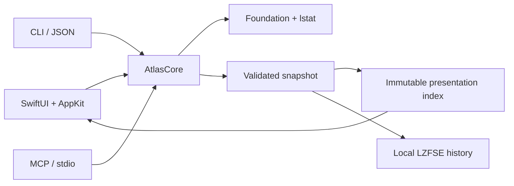

# Architecture

`AtlasCore` owns the scanner, snapshot format and presentation indexes. The GUI
uses SwiftUI for layout and a virtualized AppKit table for rows. CLI and MCP share
the scanner and JSON snapshot model; neither needs the GUI or a network listener.

CLI command declarations generate parsing and help through Swift Argument Parser.
`schema` exposes that same help in a compact effect catalog. Query DTOs omit internal
child arrays and fingerprints; scoped index queries retain only offset + limit
candidates. History commands load existing archives without source scans. One
foreground worker handles each CLI call, with a separate progress timer and
cooperative signal cancellation. See [CLI.md](CLI.md) for JSON and exit contracts.

## Data and safety

The scanner reads metadata with `lstat`, includes hidden files and application
packages, skips symlink traversal and stops at device boundaries. Hard links are
counted once across selected roots. Overlapping paths and APFS aliases are merged.
File names are untrusted data and are never evaluated as commands or instructions.

The scanner has no delete, move, cleanup, content execution or privilege escalation
operations. GUI history and explicitly requested snapshot exports are local writes.
CLI/MCP exports use exclusive creation and mode 0600. Imported snapshots validate
version, structure, cycles, connectedness, totals and integer overflow, up to 2 GiB.

Snapshots are observations over time, not atomic filesystem snapshots. macOS
permissions can exclude protected directories. APFS clones and shared blocks mean
allocated size is not a promise of reclaimable space.

## Explicit duplicate checking

`DuplicateFinder.prepare` refreshes metadata for files known to a scan and groups
regular, locally available files by logical size. It does not read contents.
Options constrain size and type; date criteria retain groups with at least one
matching copy, including other-age peers. New paths need a fresh ordinary scan.

Only `run` reads contents: GUI opt-in before Analyze authorizes automatic
background start after the map is ready; an existing scan uses Start comparison.
CLI requires `--read-contents`, MCP requires `readContents: true`. The GUI has no
date restriction; CLI/MCP retain optional date criteria. Equal-size buckets first receive 64 KiB prefix/suffix
samples; files up to 1 MiB receive a complete SHA-256 once. Only sample survivors
are fully hashed, then same-hash files are compared byte by byte. Buffers are at
most 1 MiB; reads bypass normal caching with `F_NOCACHE`. Files are opened with
`openat` and `O_NOFOLLOW` on every path component; the final descriptor also uses
`O_NONBLOCK`, and device/inode/size/mtime/ctime are checked before and after reads.
Cloud-only placeholders and nonregular files are skipped. There is no atomic
filesystem snapshot guarantee; reports are dated observations.

`DuplicateSession` is a separate observable model. Worker progress and partial
groups are batched, keeping updates out of the main map store. Pause and cancel
checkpoints occur between read chunks. Foreground scanning/indexing temporarily
pauses the background job. Confirmed groups survive stop as a partial report.
A path-to-group lookup is built off the main thread for file-list badges. Trash
selection marks mean Trash candidates. A mandatory review identifies selected paths and any unselected copies; fully selected groups are explicitly warned; confirmation starts off-main revalidation and native recoverable Trash moves. No permanent deletion or CLI/MCP cleanup exists. A check that finishes before its scan
archive is attached persists its report when the history UUID becomes available.

## Rendering and storage

Scanning, snapshot decoding, compression and index construction run off the main
thread. The immutable index caches both size orderings, descendant ranges and type
totals. Filtered queries use a bounded top-K heap and cancellation checks. Only the
first 1,000 matches render; the full match count remains visible.

Size/date view filters construct a derived snapshot and index off the main thread;
the saved snapshot remains unchanged. Native range controls preview locally while
dragging and commit once on release. Table headers and cells share native column
geometry, with a trailing gutter for percentages. Nested canvas hit testing uses
the same bounded layout as drawing. A single map click selects the exact hit for
the inspector without changing the current directory, including nested folders
and files. Direct-child selections are included in the bounded list and scrolled
to; deeper selections remain highlighted in the map and inspector. Aggregate
tiles are inert. Inspector content is constrained to its viewport width so long
paths cannot stretch or shift the panel.

File tables and expanded duplicate groups use SwiftUI's native Quick Look panel.
Only an explicit Space/context-menu/eye action supplies a selected file URL;
no contents are prefetched or embedded in snapshots. Preview item collections are
bounded by the rendered list (1,000 files, or 200 copies in a group). Panel arrows
update table selection or duplicate-row focus, independently of Trash checkboxes.
A small AppKit key responder keeps Space local to a copy's label and restores it
after dismissal; text fields and Trash checkbox keys keep their own behavior.
Leaving the list or collapsing a duplicate group dismisses its preview. The system
owns format support, preview loading/animation and missing-file presentation.

Native NSSplitViewController items remain mounted when collapsed; their animator
moves the divider in 220 ms, preserving resized pane widths. SwiftUI environment
values cross hosting boundaries, including Reduce Motion, appearance and disabled
state. Map state is isolated from unrelated observable-store updates; only the
selected branch invalidates nested Canvas artwork. Single clicks are immediate;
activation requires a second click on the same entry. Folder entry is explicit
through double-click, Explore folder or an Open action. The inspector's type
filter names the current list directory separately from the selected item.

Duplicate counts are precomputed per ancestor off-main. Folder links filter groups
off-main before sorting and bounding the visible results. DuplicateTrashPlan
requires valid scope, distinct file identities and unique selected paths. It records
remaining copies separately from a comparison reference. Every checkbox is
editable; selecting a group selects all its copies.
DuplicateTrashExecutor rechecks all selected byte pairs before the first move,
then revalidates reference/file metadata before each native Trash call. If every
copy is selected, the reference moves last; no keeper is silently imposed. Errors and
cancellation stop the batch, retain completed moves and update/persist only those
paths. A live filesystem still offers no atomic multi-file snapshot guarantee.

Treemap work is bounded by visible tile count, geometry and nesting depth. Small
objects are aggregated. The previous large index is retained through the visual
transition and released in a background task to reduce main-thread deallocation.

History stores lightweight records separately from LZFSE-compressed snapshots in
`~/Library/Application Support/Disk Atlas/History`. Directory mode is 0700; files
are 0600. Opening history never rescans source folders. Normal app termination
waits for an in-progress history write. History has no automatic pruning yet. Users can delete a snapshot or clear history
after the configured confirmation. Cleanup unlinks only UUID-named app archives
and UUID-named duplicate-report JSON sidecars plus the history manifest; source paths and exported snapshots are never targets.
The scanner maintains a cheap running estimate of uncompressed metadata; history
records report compressed archive size plus the saved duplicate-report size.
Duplicate reports are limited to 256 MiB on read/write, use mode 0600, and are
removed together with the owning history record. Termination waits for writes;
a running duplicate job is stopped and its partial result saved.

The shared 30-point status row observes duplicate updates separately from the map.
Its compact result button contains the duplicate label, state/count and chevron;
phase progress and pause/stop remain adjacent. Scan metadata and snapshot storage
size share the same row. Optional notices truncate before job controls, preserving
the layout at the minimum window width. A decorative spinner is hidden from
accessibility so the result action keeps its button role.

## Build and validation

Swift 6 / Xcode Command Line Tools, macOS 14+ deployment target. The CLI statically links Apple Swift Argument Parser
1.8.2 (pinned with its lockfile and license); AtlasCore and GUI have no external package dependencies. `scripts/build.sh` builds locally; `scripts/release.sh` compiles arm64
and x86_64, combines executables, signs ad hoc and packages DMG/ZIP with checksums.

The project uses [the shared quality gate](QUALITY.md), behavior/property tests,
selected mutation checks and manual native UI validation. Complexity legacy debt
and the separate changed-Core and production-script coverage/CRAP scopes are reported explicitly.
Shell entry points are thin POSIX adapters. `scripts/build.py` owns packaging;
`scripts/quality` separates tool bootstrap, process orchestration, language adapters,
structural rules and coverage calculation. Their Python imports must remain acyclic.
Pinned tools live in a private ignored venv, and tooling tests live in `scripts/tests`.
The gate audits its own production code and tests rather than exempting them.
An Intel slice can be built on
Apple Silicon, but this does not replace validation on physical Intel hardware.

## 0.3.0 validation scope

Scratch checks exercise unequal-size/sample pruning, same-edge/different-middle
files, exact groups, date peers, hard links, symlink/path replacement, special
files, pause/resume, cancellation, view totals, sorting, report permissions and
history cleanup without source changes. Manual UI review covers EN/RU, both
themes, minimum window size, native headers, filters and badge-to-group navigation.
These checks are outside the repository; no durable test artifacts are added.
